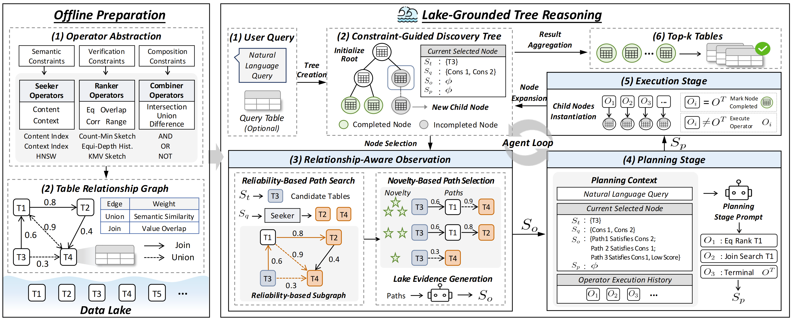
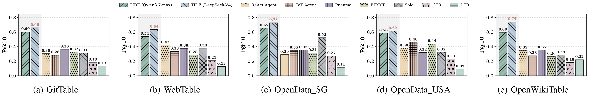
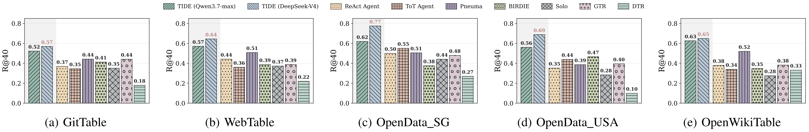

# 🌊 TIDE: Agentic Natural Language Table Discovery over Data Lakes

Official implementation of **TIDE**, an agentic framework for natural-language (NL) table discovery
over data lakes. TIDE formulates discovery as an **adaptive multi-step retrieval process**, using
intermediate tables and data lake evidence to guide subsequent discovery.

TIDE couples two components:

- **Constraint-level operators** provide composable actions: *seekers* ground NL requirements,
  *rankers* assess value or relational conditions, and *combiners* combine partial results.
  Their fine-grained compositions realize common discovery operations and support retrieval
  effectiveness and storage efficiency.
- **Lake-grounded tree reasoning** organizes exploration as a constraint-guided discovery tree.
  Each branch tracks candidate tables and unresolved query constraints. Relationship-aware
  observation selects reliable paths reaching unexplored tables and summarizes them into evidence
  for planning and execution.

> The benchmark generator lives in [`TIDEdataset/`](TIDEdataset/).

## 🧭 Method at a glance

<p align="center">
  
</p>

Offline preparation builds column indexes, sketches, and a weighted table relationship graph.
Online discovery iteratively selects a tree node, observes lake evidence, plans operator calls,
and executes them to update candidate tables and unresolved constraints. Results are aggregated
from non-error leaves when discovery terminates.

## 📊 Results

We evaluate TIDE on five data lakes with **38,334 tables and 261 queries**, against five NL table
retrievers and two agentic baselines. Both Qwen3.7-Max and DeepSeek-V4-Pro variants outperform the
baselines in precision and recall across the five datasets.

<p align="center">
  
</p>

**Precision@10.** With DeepSeek-V4-Pro, TIDE improves average P@10 from the strongest baseline's
**0.363 to 0.676**, a relative gain of **86%**.

<p align="center">
  
</p>

**Recall@40.** With the same backbone, TIDE improves average R@40 from the strongest baseline's
**0.472 to 0.665**, a relative gain of **41%**.

## 📁 Repository structure

```
TIDE/
├── main.py                    # entry point: async per-query driver (offline build + online discovery)
├── eval.py                    # Precision@k / Recall@k / NDCG@k evaluation
├── config.yaml                # all runtime knobs (paths, thresholds, agent loop, navigation)
├── requirements.txt
├── src/
│   ├── agent.py               # TableAgent — the observe–plan–execute loop (Algorithm 1, online)
│   ├── reasoning_tree.py      # constraint-guided discovery tree (nodes, utility, result aggregation)
│   ├── relationship_graph.py  # table relationship graph G_R + reliability-based path search
│   ├── tgr.py                 # novelty-based path selection + path rendering
│   ├── query_constraint.py    # parse the query into structured column constraints s_q
│   ├── operators/
│   │   ├── seeker.py          # content / context seekers (ground NL descriptors)
│   │   ├── ranker.py          # eq / range / overlap / corr rankers (score verification conditions)
│   │   └── tool.py            # the agent's action space (operators + combiner + terminate)
│   ├── col_filter.py          # per-column sketches: Count-Min, equi-depth histogram, KMV
│   ├── col_formatter.py       # column content / context serialization for embedding
│   ├── col_name_matcher.py    # semantic column-name matching (bridges renamed columns)
│   ├── vdb_searcher.py        # FAISS HNSW vector index over column/metadata embeddings
│   ├── table.py               # Table abstraction + matched-column metadata and scores
│   └── utils.py               # operator wiring, prompt templates, token accounting
└── TIDEdataset/               # benchmark generator (separate README)
```

## ⚙️ Installation

```bash
conda create -n tide python=3.10 -y && conda activate tide
pip install -r requirements.txt
```

Key dependencies: `agentscope` (agent framework), `faiss-cpu` (vector search), `sentence-transformers`
+ `transformers` + `torch` (embeddings), `openai` (LLM API), `pandas` / `numpy` / `scipy`.

**Embedding model.** TIDE embeds columns with `bge-large-en-v1.5`. `config.yaml` defaults to the
HuggingFace id `BAAI/bge-large-en-v1.5` (auto-downloaded); set it to a local path to load the embedding model offline.
Index dimensions follow the encoder hidden size. Alternative encoders must support the existing
CLS-token pooling; changing the model requires a fresh `vdb_dir`, even if its dimension is unchanged.

**LLM backend.** The default is DashScope. Set the API key in the environment variable named by
`llm_api_key_env`, and choose an available model using `llm_backbone` in [`config.yaml`](config.yaml):

```bash
export DASHSCOPE_API_KEY="your-key"
```

DashScope uses two endpoints: `llm_base_url` for constraint extraction through its OpenAI-compatible
API, and `llm_dashscope_base_url` for agent calls through its native API. Configure both for your region.
To use another OpenAI-compatible Chat Completions service, configure:

```yaml
llm_provider: openai
llm_backbone: your-model-name
llm_api_key_env: OPENAI_API_KEY
llm_base_url: https://your-service.example/v1
```

```bash
export OPENAI_API_KEY="your-key"
```

In this mode, constraint extraction and all agent stages use the same endpoint and model.
The service must support tool calling, including `tool_choice`; DashScope-specific parameters are omitted.
`llm_dashscope_base_url` is ignored. No API keys are stored in configuration files.

## 🗄️ Data

TIDE runs on benchmark splits produced by [`TIDEdataset/`](TIDEdataset/). Point `config.yaml` at them:

```yaml
datalake_dir: TIDEdataset/dataset/datalakes   # parent of the generated splits
dataset: WebTable                             # the split to run on
```

Each split provides `aug_lakes/` (the searchable lake), `input_tables/` (optional seed tables),
`query.json`, and `metadata.json` (ground truth, used only for evaluation). To run on your own data
lake, match that layout.

## 🚀 Quick start

```bash
# 1. configure: set dataset + paths in config.yaml, and export DASHSCOPE_API_KEY

# 2. run discovery (first run also builds the indexes/graph cache under vdb_dir)
python main.py --dataset WebTable                 # -> results/WebTable/tide.json

#    options: --idxs 0,1,2 (subset)  --concurrency N  --out <path>  --log <path>

# 3. evaluate against ground truth
python eval.py --dataset WebTable                 # -> eval/WebTable/tide.json
```

`main.py` writes one record per query as `{idx, query, candidates}`; `eval.py` reports
Precision@k, Recall@k, and NDCG@k against each split's `metadata.json`.

## 🔍 How it works

**Constraint-level operators (paper §4).** Operators return candidate tables with grounded columns and scores:

- *Seekers* ([`seeker.py`](src/operators/seeker.py)) ground an NL descriptor to candidate columns via
  two complementary signals — content (name + values) and context (description) — each embedded and
  indexed with HNSW ([`vdb_searcher.py`](src/vdb_searcher.py)).
- *Rankers* ([`ranker.py`](src/operators/ranker.py)) score candidates against verification requirements:
  `eq` (Count-Min), `range` (equi-depth histogram), `overlap` and `corr` (KMV sketch) —
  all in [`col_filter.py`](src/col_filter.py).
- *Combiners* ([`tool.py`](src/operators/tool.py)) compose partial results with set operations
  (intersection / union / difference).

**Lake-grounded tree reasoning (paper §5).** The agent ([`agent.py`](src/agent.py)) maintains a
constraint-guided discovery tree ([`reasoning_tree.py`](src/reasoning_tree.py)). Each iteration:

1. selects the highest-utility incomplete leaf;
2. runs **relationship-aware observation** — reliability-based path search over the precomputed
   relationship graph ([`relationship_graph.py`](src/relationship_graph.py)) followed by
   novelty-based path selection ([`tgr.py`](src/tgr.py)) — and summarizes the paths into
   lake-grounded evidence;
3. **plans** the next operator(s) from that evidence, then **executes** them, expanding child nodes
   and discharging query constraints only when a returned binding verifies them.

## 🎛️ Configuration

All knobs live in [`config.yaml`](config.yaml); paths are relative to the repo root.

| key | meaning |
|---|---|
| `datalake_dir`, `dataset` | parent dir of splits, and the split to run |
| `vdb_dir` | cache for vector indexes + sketches (built on first run) |
| `emb_model_path` | embedding model (HF id or local path) |
| `llm_backbone` | model used for constraint extraction and all agent stages |
| `llm_provider`, `llm_api_key_env` | service adapter (`dashscope` or `openai`), API-key environment variable |
| `llm_base_url`, `llm_dashscope_base_url` | OpenAI-compatible endpoint, DashScope native endpoint |
| `col_match_threshold`, `vdb_score_threshold` | cosine floors for column-name matching / vector search |
| `ranker.*` | correlation sign mode / threshold, numerical range fraction |
| `agent.max_loop`, `agent.max_attempts`, `agent.per_query_timeout_s`, `agent.concurrency` | planning budget, discovery attempts per query, per-query timeout, concurrency |
| `agent.enable_constraint_revision` | optional branch-constraint revision during execution (default: `false`) |
| `tree.cand_top_k` | per-node candidate cap shown to the planner |
| `tools.result_cap` | max tables returned by one operator call |
| `result.final_top_k`, `result.final_min_constraint_match` | output cap, per-table constraint filter |
| `navigation.k_1`, `navigation.k_o`, `navigation.d_o` | reliable path pool, paths surfaced to observation, DFS depth |


Constraint revision is disabled by default. When enabled, execution can use one additional LLM
call per stage to add overlooked requirements or revise inherited constraints for successful
child branches. Updated constraints are verified against returned tables, and final ranking uses
each branch's complete revised requirements. Leave this option disabled to use the evaluated workflow.
